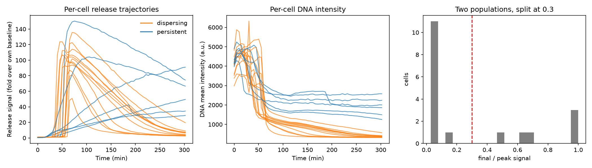

# NETScope

Single-cell analysis of a neutrophil time-lapse: who releases their DNA, when,
and whether the trajectory looks like NETosis or like a slower permeabilisation.

Most published NETosis image analysis reports a count per field per hour. This
pipeline instead gives each cell its own trace and classifies it on the **shape**
of that trace, which separates two populations the field-level measurement
averages together.



## The data 

A 300 x 300 px crop of a widefield fluorescence time-lapse of primary human
neutrophils, from [addoyle1D/CPCB_NETosis](https://github.com/addoyle1D/CPCB_NETosis),
where it ships alongside a set of ImageJ macros.

| frames | 61 |
| --- | --- |
| interval | 302 s (5.0 min), 5.0 h total |
| pixel size | 0.325 µm (20x objective, 6.5 µm camera pixels) |
| channel 0 | DAPI — all nuclei |
| channel 1 | FITC (ex 480 / em 535) — a cell-impermeable dye, so it reports released DNA |
| source file | `1_WT-0-1.nd2`, Nikon Ti + Hamamatsu Flash4.0, NA 0.75 |

The stimulus and its concentration are not documented in the source repository.

## What it finds

Eighteen cells, splitting into two groups by the ratio of their final to peak
release signal, with an empty gap in the distribution between 0.14 and 0.50:

| | n | release half-max | final / peak |
| --- | --- | --- | --- |
| **dispersing** | 12 | median 58 min (40–66) | < 0.15 |
| **persistent** | 6 | median 106 min (55–156) | > 0.49 |

Dispersing cells rise sharply, peak around an hour, then fall back to a few
percent of peak: the chromatin spreads out and the signal with it. Persistent
cells rise later and stay bright. The same split is visible in the DNA channel,
where dispersing cells show an abrupt collapse in intensity and persistent cells
decline gradually.

This reproduces, per cell, the distinction the source macros draw by subtracting
the final frame from the whole field — but at 5-minute resolution, with the
threshold chosen from a visible gap in the data rather than assumed.

## What it cannot find

Whether nuclear decondensation precedes membrane rupture. The two half-max
crossings fall in the same frame for 11 of 12 dispersing cells, and one frame
apart for the twelfth. **At a 5-minute interval the ordering is unresolvable**;
answering it would need intervals of roughly 30 s to 1 min.

## Running it

```bash
pip install -r requirements.txt
python scripts/01_inspect.py          # metadata, frame summary, montage
python scripts/02_segment_measure.py  # segment cells, per-cell traces
python scripts/03_timing.py           # onset times, kinetics, lag
python -m pytest tests -v             # synthetic-data checks
```

Paths, channel indices and acquisition metadata live in `config.yaml`; nothing
is hardcoded in the scripts.

## How it works

1. **Segment once, not per frame.** Nuclei decondense and dim as the experiment
   runs, so a per-frame Otsu threshold silently loses them — 19 objects at t=0
   but only 6 by the end. Instead cells are defined once from the maximum
   intensity projection of the DNA channel, which catches every nucleus at its
   brightest. The cells barely move in this field, so fixed regions hold.
2. **Measure both channels** inside each region at every frame →
   `results/tables/02_cell_traces.csv`, one row per cell per frame.
3. **Classify on trajectory shape** using final / peak signal, each cell
   normalised to its own baseline.
4. **Time each event** by the half-maximum crossing of that cell's own trace.
   Half-max rather than first-departure-from-baseline, because the peak is
   30–150x baseline so the midpoint sits far above the noise.

## Limitations

- About 18 of roughly 22 visible nuclei are segmented; the faintest never cross
  the threshold even in projection.
- Two regions look like touching nuclei counted as one. Marker-controlled
  watershed would split them.
- Regions are fixed, so as a nucleus expands the region covers only its core.
  Measurements describe the nuclear core, not the full spreading chromatin.
- The 0.3 classification cutoff comes from the gap in these 18 cells and would
  need re-checking on a larger sample.
- One field, one condition, no replicates. Nothing here is a statistical claim
  about neutrophils in general.

## Next

Per-cell tracking rather than fixed regions, so expanding chromatin stays
inside its own measurement; watershed to split touching nuclei; and the same
analysis across inhibitor conditions, where the kinetics curves become
comparable survival curves.

---

Built as an M.Sc. Bioinformatics project. Data courtesy of
[addoyle1D/CPCB_NETosis](https://github.com/addoyle1D/CPCB_NETosis).
